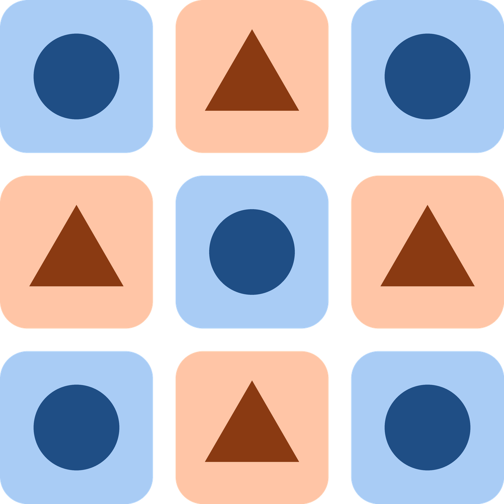

# Blockade



Turn-based board game built with Python + [Flet](https://flet.dev). Two sides (Blue ● and
Orange ▲) place blocks on a square board (as big as the screen allows: about 7×7 on a
phone, up to 14×14 on a tablet). Whoever squeezes the opponent's blocks in a
straight line, between the new block and another block of their own, turns all of them to
their side. The player with the most blocks when the board is full wins.

> The app is called **Blockade**; the game's on-screen text is in Portuguese.
>
> Renamed from *Guerra dos Blocos*. If you installed the project before the rename, run
> `pip uninstall -y guerra-dos-blocos` once, then `pip install -e ".[dev]"` again.

**Contents:** [Quick start](#quick-start) · [1. Setup](#1-setup-once) ·
[2. Run](#2-run-the-game) · [3. Test](#3-test) · [4. Debug](#4-debug) ·
[5. Android](#5-build-for-android) · [6. iOS](#6-build-for-ios) ·
[Rules](#game-rules) · [Project structure](#project-structure)

---

## Quick start

```bash
cd blockade
python -m venv .venv && source .venv/bin/activate     # Windows: .venv\Scripts\activate
pip install -e ".[dev]"
flet run
```

A desktop window opens with the game menu. That's it.

---

## 1. Setup (once)

**You need:** Python **3.10+** (3.12 recommended). Android/iOS builds have extra needs,
covered in their own sections.

```bash
cd blockade                      # the folder that contains pyproject.toml
python -m venv .venv
source .venv/bin/activate        # Windows (PowerShell): .venv\Scripts\Activate.ps1
pip install -e ".[dev]"
```

What gets installed:

| Package | Why |
|---|---|
| `flet` | The UI framework. This is the **only** runtime dependency that gets bundled into the phone app. |
| `flet[all]` (dev) | The `flet` command (`run`, `build`, `debug`...) plus the desktop and web runners. |
| `pytest`, `pytest-cov` (dev) | Tests and coverage. |

`-e` (editable) means code changes take effect without reinstalling.

Check it worked:

```bash
flet --version     # prints the Flet and Flutter versions
pytest -q          # all tests should pass
```

---

## 2. Run the game

Always run these commands **from the project folder** (where `pyproject.toml` is).

| What | Command |
|---|---|
| Desktop window | `flet run` |
| Desktop + **hot reload** (restarts when any file in `src/` changes) | `flet run -r` |
| In the browser | `flet run --web` |
| On your Android phone, no build needed | `flet run --android` |
| On your iPhone, no build needed | `flet run --ios` |
| Without the Flet CLI | `python src/main.py` |

**How `flet run` finds the game:** `pyproject.toml` tells it where the app is:

```toml
[tool.flet.app]
path = "src"     # app folder
module = "main"  # -> src/main.py, which calls ft.run(main)
```

`flet build` uses the same settings, so anything that runs with `flet run` gets packaged
the same way.

**Try it on a real phone in 1 minute** (`--android` / `--ios`): install the free **Flet**
app from Google Play or the App Store, connect the phone to the **same Wi-Fi** as your
computer, run the command and scan the QR code printed in the terminal. Hot reload works
there too.

> The first `flet run` downloads the Flet desktop client once (needs internet). It is
> cached for later runs.

---

## 3. Test

The game rules, bot, math questions, save file and screen wiring are all covered by tests.
**The tests do not need a window or a phone**, and most of them don't even need Flet.

```bash
pytest                              # everything (~10 s)
pytest -m "not slow"                # skip the bot-balance tournament (~4 s)
pytest tests/test_board.py          # one file
pytest -k undo                      # only tests with "undo" in the name
pytest -x --lf                      # stop at first failure / re-run last failures
pytest --cov=blockwar --cov-report=term-missing   # coverage report
```

What each test file covers:

| File | Covers |
|---|---|
| `test_board.py` | Capture rule. Includes property tests against a reference implementation on thousands of random boards. |
| `test_game.py` | Turns, skip, undo, end of game, winner/draw |
| `test_bot.py` | The three bot levels (random / greedy / corner-aware with lookahead) |
| `test_mathmode.py` | Math page settings: chosen operations only, results up to 100, chosen times tables, exact division, saving and converting old saves |
| `test_controller.py` | Game flow without UI: taps, questions, bot turn, undo, hint, records, full matches |
| `test_storage.py` | Save file: round trip, corrupt/invalid files, atomic writes |
| `test_theme.py` | Pastel palette (every colour pastel, every symbol readable), level colours, cell looks, score bar, and the board size for each screen (phone ~7×7, tablet up to 14×14) |
| `test_simulate.py` | Bot-vs-bot simulation and CLI (balance guard marked `slow`) |
| `test_ui_wiring.py` | Flet screens. Each test runs twice: with a **fake** Flet (logic only) and with the **real** Flet control classes (catches wrong control names, arguments or enum values). |
| `test_project_config.py` | The `flet run` / `flet build` configuration, the `src/main.py` entry point, the app name and the app icon (size, transparency, matches `tools/make_icon.py`) |

Notes:

- The UI tests **do not check how the screen looks**. After UI changes, always run
  `flet run` and look at it.
- A test marked `xfail` documents a **known bug** that hasn't been fixed yet (see
  `pytest -ra` output). When the bug is fixed the test starts passing: pytest then
  reports it as `XPASS(strict)` and fails the run, so remove the `xfail` mark.
- Tests never touch your real scores: each test gets its own temporary save file
  (`tests/conftest.py`).

**Bot balance check** (computer vs computer, useful after changing the rules or the bot):

```bash
python -m blockwar.simulate --games 40 --size 7 --blue dificil --orange facil
# levels: facil (easy), medio (medium), dificil (hard)
```

---

## 4. Debug

### See logs

```bash
flet run -v       # Flet + app logs at INFO level
flet run -vv      # DEBUG level (very verbose, includes every UI update)
```

`-v`/`-vv` turn on Python logging for the whole process, so the game's own
`logging` messages (`blockwar.*` loggers) show up too. `print()` output always appears
in the terminal that runs `flet run`.

### Breakpoints

`flet run` starts the game in a child process, so a debugger attached to `flet run` will
not stop at your breakpoints. Run `src/main.py` directly under the debugger instead:

- **VS Code:** open the `blockade` folder, install the *Python* and *Python Debugger*
  extensions, open **Run and Debug** and pick one of the ready-made configurations
  (`.vscode/launch.json`), then press **F5**:
  - *Game: desktop window (breakpoints)*
  - *Tests: all* / *Tests: current file*
  - *Simulation: bot vs bot*

  Tests also appear in the **Testing** panel (`.vscode/settings.json`).
- **PyCharm:** create a *Python* run configuration with script `src/main.py` and working
  directory set to the project folder, then click *Debug*. For tests, use a *pytest*
  configuration on the `tests` folder.
- **Any terminal:** put `breakpoint()` in the code and run `python src/main.py`.

Tip: most bugs are in the game logic, which needs no UI. Reproduce them in a test with
`Match`, `Game` or `Board.from_text([...])` (see `tests/test_controller.py`) and debug that
test. It's much faster than clicking through the game.

### On a phone or emulator

| What | Command |
|---|---|
| Check your setup (Flutter, Android SDK, Xcode...) | `flet doctor` |
| List connected devices | `flet devices` |
| List / start emulators | `flet emulators` |
| Real debug build on a device, with live device logs | `flet debug android` / `flet debug ios` |
| Pick a specific device | `flet debug android --device-id <id>` |

`flet debug` builds the real app (same as `flet build`), installs it and streams the logs.
Use it to check things that only happen in the packaged app (storage, screen size, app
startup). For quick UI work, `flet run --android` / `--ios` is much faster.

### Save file (scores and menu choices)

| Running with | File location |
|---|---|
| `flet run` / the VS Code config | `.flet/storage/data/guerra_dos_blocos.json` (in the project, git-ignored) |
| `python src/main.py` | `~/.guerra_dos_blocos/guerra_dos_blocos.json` |

The file keeps its pre-rename name on purpose, so existing scores are not lost.
| Installed app | The app's private storage on the device |
| Any of them, overridden | The path in the `GUERRA_SAVE` environment variable |

Delete the file to reset scores. A broken file is ignored (defaults are used).

### Common problems

| Problem | Fix |
|---|---|
| `flet: command not found` | Activate the venv (`source .venv/bin/activate`) and run `pip install -e ".[dev]"`. |
| `File or directory not found: .../main.py` | Run `flet run` from the project folder, or use `flet run src/main.py`. |
| `ModuleNotFoundError: No module named 'blockwar'` | Run from the project folder, or run `pip install -e ".[dev]"` again. |
| Changes don't show up | Use `flet run -r` (hot reload), or restart `flet run`. |
| Phone can't connect with `flet run --android/--ios` | Same Wi-Fi on both devices; allow the port in your firewall. |
| Linux: window does not open | Install the GStreamer and `libmpv` system packages (see the Linux notes in the [Flet docs](https://flet.dev/docs/)). |

---

## 5. Build for Android

Works on **Windows, macOS or Linux**. You don't have to install Flutter, Java or the
Android SDK yourself: on the first build `flet build` offers to download the right
versions (answer `y`, or add `--yes`). The first build takes a while and downloads
several GB. Later builds are much faster.

### APK (install directly on a phone)

```bash
flet build apk
```

Result: **`build/apk/blockade.apk`**. Install it:

- with a USB cable: enable *Developer options → USB debugging* on the phone, then run
  `adb install -r build/apk/blockade.apk`, or
- copy the file to the phone and open it (allow *install unknown apps*).

Smaller APKs, one per CPU type: `flet build apk --split-per-abi`.

### AAB (for Google Play)

Google Play needs an **App Bundle signed with your upload key**. Create the key once and
**keep it safe**: without it you can't publish updates.

```bash
keytool -genkey -v -keystore ~/upload-keystore.jks -keyalg RSA -keysize 2048 \
        -validity 10000 -alias upload
```

Build (keep passwords out of the repo, use environment variables):

```bash
export FLET_ANDROID_SIGNING_KEY_STORE=~/upload-keystore.jks
export FLET_ANDROID_SIGNING_KEY_ALIAS=upload
export FLET_ANDROID_SIGNING_KEY_STORE_PASSWORD='...'
export FLET_ANDROID_SIGNING_KEY_PASSWORD='...'
flet build aab --build-version 0.1.0 --build-number 1
```

Result: `build/aab/blockade.aab`. Upload it in the Google Play Console.
Increase `--build-number` for every upload.

---

## 6. Build for iOS

**You need:** a **Mac** with **Xcode** (from the App Store; open it once to accept the
license) and an Apple ID. Publishing to TestFlight or the App Store also needs an
**Apple Developer Program** membership. As with Android, `flet build` installs Flutter if
needed.

| Goal | Command | Needs |
|---|---|---|
| Run in the iOS Simulator | `flet build ios-simulator` | Xcode only |
| Run on your own iPhone, with logs | `flet debug ios` | iPhone connected by cable, *Developer Mode* on, signing set up in Xcode |
| Package for TestFlight / App Store | `flet build ipa` (see below) | Developer Program, certificate and provisioning profile |

### IPA (TestFlight / App Store)

1. In the [Apple Developer portal](https://developer.apple.com/account), create an App ID
   (bundle id built from `org` in `pyproject.toml` + the project name, e.g.
   `dev.guerradosblocos.blockade`), a distribution certificate and an
   *App Store* provisioning profile. Install both on your Mac.
2. Build:

   ```bash
   flet build ipa \
     --ios-team-id ABCDE12345 \
     --ios-export-method app-store-connect \
     --ios-provisioning-profile "Blockade App Store" \
     --build-version 0.1.0 --build-number 1
   ```

   To avoid retyping, the same values can go in `pyproject.toml`:

   ```toml
   [tool.flet.ios]
   team_id = "ABCDE12345"
   export_method = "app-store-connect"
   provisioning_profile = "Blockade App Store"
   ```

3. Result: `build/ipa/`. Upload the `.ipa` with Apple's **Transporter** app (or Xcode),
   then send it to testers via TestFlight.

Without a provisioning profile the build stops at an Xcode archive (`.xcarchive`) and
produces no `.ipa`.

### Build settings (both platforms)

| Setting | Where |
|---|---|
| App name on the phone | `[tool.flet] product` |
| Bundle id / package name | `[tool.flet] org` + `[project] name` (or `[tool.flet] bundle_id`) |
| Version shown to users | `[project] version`, or `--build-version` |
| Build number | `--build-number` (must grow with every store upload) |
| Dependencies bundled in the app | `[project] dependencies` (keep dev tools in the `dev` extra!) |

All options: `flet build --help` and the [Flet publishing docs](https://flet.dev/docs/publish).

---

## Game rules

- Any empty square is a valid move; capturing is a consequence, not a requirement.
- In each of the 8 directions, a sequence of opponent blocks enclosed by one of your
  blocks is turned to your side.
- Captures do not chain: blocks turned during a move do not capture again during that move.
- Corner blocks can never be squeezed.
- The game ends when the board is full (or one side has no blocks left). Boards with an
  even number of squares (6×6, 8×8, ...) can end in a tie (*Empate!*).

### Screens

The game is built for a 7-year-old to use alone: soft pastel colours, text-only buttons
(no pictures to decode) and one thing per screen. The menu and the math page share the
same layout: the choices in the middle of the screen, then a gap, then **Jogar!** (Play)
near the bottom edge where the thumbs are, in exactly the same place on both screens.

```
Menu ──Jogar!──▶ Game, with the "Como jogar" window on top ──Entendi!──▶ play
  └─ Praticar matemática ──Jogar!──▶ (same)            (◀ Voltar = back to Menu)
Game ──Jogar de novo──▶ Game (no tutorial window the second time)
```

| Screen | What is on it |
|---|---|
| **Menu** | At the top, the app icon and the name **Blockade**. In the middle: *Quem vai jogar com você?* (**Um amigo** / **O celular**) and, against the phone, *Quão esperto é o celular?* as three coloured cards: **Fácil** green, **Médio** yellow, **Difícil** red (the chosen one is stronger and has a border). Then **Praticar matemática** (shows the chosen signs, e.g. `+ ×`, when math is on) and, last, **Jogar!**. |
| **Praticar matemática** | Only the four signs **+ − × ÷** (tap to turn each on/off, any mix; none = no math). With × or ÷ the **Tabuada** row (1–10, several at once) appears below. Results never pass 100 (e.g. 99 + 1, 10 × 10). Last button: **Jogar!**, no need to go back to the menu. |
| **Game** | Whose turn it is (with a round **?** button at the top right), the score, and the board. When a game starts from **Jogar!**, the **Como jogar** tutorial opens as a small window on top of the board (only as big as its text, with a picture of a capture in the game's colours). The **?** button opens it again at any time. The board can't be touched until **Entendi!** is pressed. |

### Playing on screen

1. Tap an empty square: the blocks that would be turned are highlighted in yellow.
2. Tap the same square again to confirm (or tap another square to change the selection).
3. **Dica** (hint) highlights a suggested square in green. **Desfazer (3)** (undo) goes
   back one move; the number shows how many undos are left in this game. Both are
   beginner helpers: they only appear against the phone on **Fácil**.

Modes: play against the phone (Easy, Medium, Hard) or two people on the same device.
**Math questions**: after confirming a square you must answer a multiple-choice question
(4 options) built from the choices on the math page. A wrong answer loses your turn.
Results are never above 100 and never below zero; × and ÷ use only the chosen times tables
(up to 10 × 10), and every division is exact.

---

## Project structure

```
blockade/
├── pyproject.toml          # dependencies + Flet run/build config + pytest config
├── src/
│   ├── main.py             # entry point used by `flet run` and `flet build`
│   ├── assets/icon.png     # app icon (launcher icon + top of the menu)
│   └── blockwar/           # the game package (bundled into the app)
├── tools/make_icon.py      # draws assets/icon.png from the game's colours (needs Pillow)
├── tests/                  # pytest suite (not bundled)
└── .vscode/                # debug configurations and test settings for VS Code
```

| File | Purpose |
|---|---|
| `src/main.py` | Entry point: `ft.run(main)` |
| `src/blockwar/models.py` | Players, positions, and errors |
| `src/blockwar/board.py` | Immutable board and capture rules |
| `src/blockwar/game.py` | Game state: turns, undo, and game over |
| `src/blockwar/bot.py` | Three-level computer opponent |
| `src/blockwar/mathmode.py` | Math settings (operations, numbers, times tables) and questions |
| `src/blockwar/controller.py` | Game flow (taps, questions, and device), without Flet |
| `src/blockwar/theme.py` | Square colors and appearance, without Flet |
| `src/blockwar/ui.py` | Flet screens (menu and game). The **only** module that imports Flet. |
| `src/blockwar/storage.py` | Scores and settings stored as JSON |
| `src/blockwar/simulate.py` | Computer-vs-computer simulation for checking balance |

All game rules are kept outside Flet, so they can be tested without opening a window.
`tests/test_project_config.py` makes sure only `ui.py` imports Flet.
